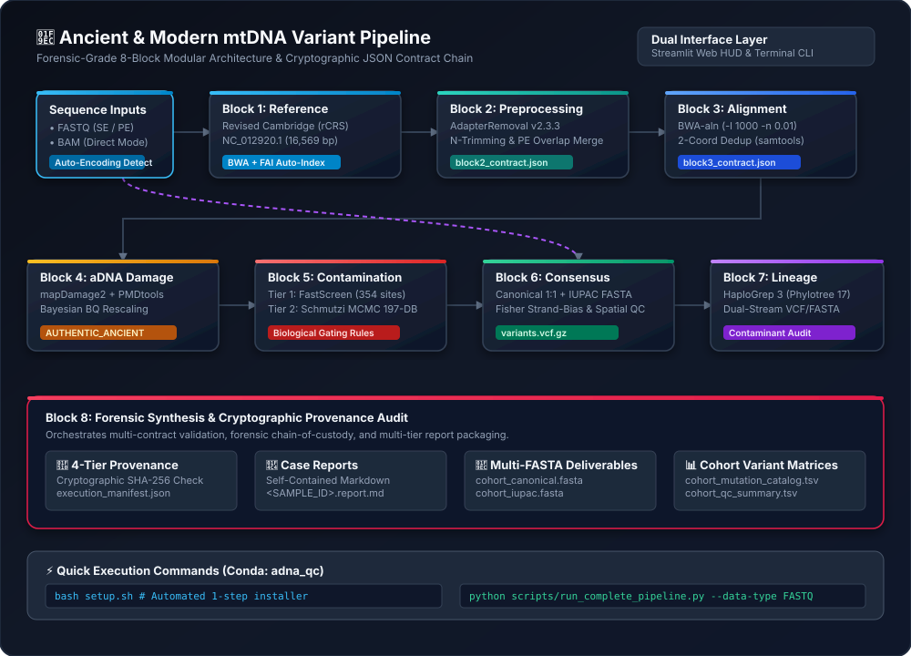
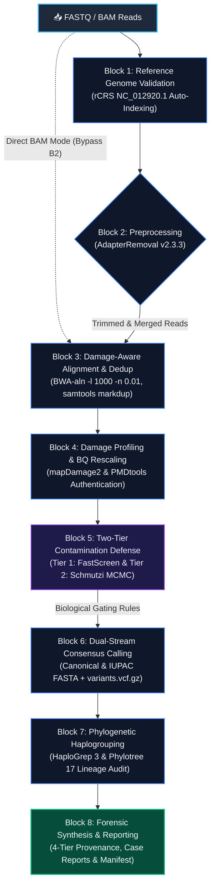

# 🧬 mtDNA Forensic & Ancient DNA Analysis Pipeline

[](config/default_config.yaml)
[](https://www.python.org/)
[](LICENSE)
[]()

The **mtDNA Forensic & Ancient DNA Analysis Pipeline** is an end-to-end bioinformatics pipeline implemented as a Python application (`scripts/run_complete_pipeline.py`) built for **Ubuntu / Debian** (both native Linux and Windows via **WSL2**). It operates within an isolated environment managed by **Conda** or **Miniconda**, which packages and coordinates all external bioinformatics binaries (`bwa`, `samtools`, `AdapterRemoval`, `mapDamage2`, `pmdtools`, `haplogrep3`, and R statistical runtimes). The pipeline processes raw sequencing reads (`FASTQ`) or pre-aligned `BAM` files and automates the entire analytical lifecycle for ancient and modern mitochondrial DNA: quality trimming, damage-aware alignment, post-mortem deamination authentication, contamination quantification, high-resolution consensus calling, and Phylotree 17 haplogroup assignment. Ready to get started? **[Jump directly to Automated Setup (`setup.sh`)](#-installation--environment-setup)**.

Under the hood, the pipeline relies on a compartmentalized 8-block architecture where every stage communicates through cryptographically sealed JSON contracts. Researchers can run analyses interactively through a web-based Streamlit Graphical HUD or headless via CLI on HPC clusters, backed by a detached supervisor daemon that prevents PID-recycling hazards. Degraded aDNA fragments are aligned non-destructively with seeding disabled, profiled for cytosine deamination, and screened through a two-tier contamination defense that pairs rapid allelic triage across 354 diagnostic sites with full Bayesian MCMC modeling (*Schmutzi* or *DissentEngine*). Automated biological gating blocks heavily contaminated samples from producing chimeric sequences, while spatial filtering suppresses terminal deamination artifacts before dual-stream variant calling. Finally, a 4-tier provenance audit verifies SHA-256 hash continuity across the entire run and packages the results into a clean `results/` folder containing individual forensic case reports (`.report.md`), canonical and IUPAC multi-FASTA files, tidy mutation catalogs (`.tsv`), cohort QC summaries, and a cryptographic Root of Trust manifest (`execution_manifest.json`).

<p align="center">
  
</p>



---

## 🔍 In-Depth Workflow Mechanics (Blocks 1–8)

### Block 1: Reference Genome Validation (`ReferenceManager`)
The pipeline begins by loading and cryptographically verifying the Revised Cambridge Reference Sequence (`NC_012920.1`, 16,569 bp). It validates sequence checksums (MD5 and SHA-256), automatically builds any missing BWA or `.fai` indexes, and ensures circular coordinate wraparound support is ready for downstream alignment.

### Block 2: Read Discovery & Preprocessing (`PreprocessingEngine`)
Raw `FASTQ` files are inspected for structural integrity, truncated blocks, or corrupted gzip streams while automatically inferring Phred quality encoding (Phred+33 vs Phred+64). `AdapterRemoval` then strips sequencing adapters, trims terminal ambiguous `N` bases, discards fragments shorter than 30 bp, and collapses overlapping paired-end reads into full-length merged fragments. When running in direct `BAM` input mode, this stage is bypassed automatically.

### Block 3: Alignment, Quality Filtering & Deduplication (`AlignmentOrchestrator`)
Reads are mapped to the rCRS using `bwa-aln` with seeding disabled (`-l 1000 -n 0.01 -o 2`) so that post-mortem terminal mismatches on ultrashort fragments are not penalized. PCR duplicates are removed using two-coordinate deduplication (`samtools markdup` in `both` mode) to retain only independent DNA molecules, while unmapped reads, secondary alignments (`0x100`), supplementary alignments (`0x800`), and low-quality mappings (`MAPQ < 30`) are filtered out.

### Block 4: aDNA Damage Profiling & Quality Rescaling (`DamageOrchestrator`)
Cytosine deamination rates ($C \to T$ at $5'$ ends and $G \to A$ at $3'$ ends) and fragment length distributions are quantified via `mapDamage2`, alongside per-read degradation scoring via `PMDtools`. The module fits a Bayesian statistical model to downscale Phred quality scores on bases susceptible to post-mortem deamination—preventing ancient damage from triggering false-positive variant calls—and emits a sealed `block4_contract.json` classifying the specimen as `AUTHENTIC_ANCIENT_SUPPORTED`, `INCONCLUSIVE`, or `MODERN`.

### Block 5: Two-Tier Contamination Estimation & Gating (`ContaminationBatchRunner`)
Contamination is evaluated in two stages. First, Tier 1 (*FastScreen*) measures allelic dissent across 354 diagnostic Phylotree loci, granting clean samples an immediate `FAST_CLEAR` bypass. Samples requiring deeper inspection enter Tier 2: certified ancient specimens are conditionally subsampled to ~40x depth, annotated with MD tags (`samtools calmd`), and modeled iteratively in `Schmutzi` against 197 modern contaminant mitogenomes, whereas modern or zero-damage samples are routed to `DissentEngine` to avoid division-by-zero singularities (`-nan`). Based on the estimated contamination, the block enforces strict biological gating for Block 6: unrestricted calling up to $2\%$ (`STANDARD_CALLING`), raised VAF thresholds ($\ge 25\%$) between $2\%$ and $5\%$ (`RESTRICT_HETEROPLASMY`), mandatory PMD filtering between $5\%$ and $10\%$ (`PMD_FILTERING_REQUIRED`), and automatic execution blocking above $10\%$ (`EXCLUDE_OR_MANUAL_REVIEW`).

### Block 6: Dual-Stream Consensus & Heteroplasmy Calling (`ConsensusOrchestrator`)
For all passing samples, the consensus engine emits a canonical sequence (`sample.consensus.fasta` with major alleles $\ge 80\%$), an ambiguity-coded sequence (`sample.consensus_iupac.fasta`) capturing sub-clonal variations, and a complete variant call file (`sample.variants.vcf.gz`) detailing depth, VAF, and strand bias. To prevent residual deamination from mimicking biological heteroplasmy, spatial damage filtration suppresses candidate variants near read termini (e.g., within 5 bp for Non-UDG libraries) and masks known homopolymer artifact regions (HVS-I/II poly-C tracts and the 3107N spacer).

### Block 7: Phylogenetic Classification & Lineage Audit (`HaplogroupOrchestrator`)
Mitochondrial haplogroups are assigned via `HaploGrep3` against the Phylotree 17 database (`phylotree-fu-rcrs@1.2`) using the Kulczynski distance metric. The orchestrator performs a dual-stream concordance check by classifying both FASTA and VCF outputs simultaneously, and cross-audits private or missing mutations against the putative contaminant haplogroups identified by Schmutzi in Block 5 to expose subtle chimeric mixtures.

### Block 8: Forensic Synthesis & Reporting (`SynthesisOrchestrator`)
Before any final deliverable is written, Block 8 runs a 4-Tier Provenance Audit verifying contract completeness (Tier 1), physical file and EOF integrity (Tier 2), cross-stage numerical sanity (Tier 3), and the unbroken SHA-256 hash chain (Tier 4). Once validated, it populates the `results/` directory with self-contained Markdown forensic reports (`<SAMPLE_ID>.report.md`), cohort-wide canonical and IUPAC FASTA alignments, tidy mutation catalogs, QC summary tables, and the master `execution_manifest.json`.

---

## 📦 Installation & Environment Setup

### Prerequisites & System Requirements
* **Operating System**: 64-bit **Ubuntu 20.04+** (or Debian 11+) or **Windows 10/11 with WSL2** (Ubuntu 22.04 LTS recommended).
* **Hardware**: Minimum 4 physical CPU cores (8+ recommended for Schmutzi parallelization), 8 GB RAM (16 GB+ recommended), and ~25 GB free disk space.
* **Conda (Required)**: You must have **Miniconda** or **Anaconda** installed inside Linux/WSL2. If you do not have Conda installed yet, install it in one step:
  ```bash
  wget https://repo.anaconda.com/miniconda/Miniconda3-latest-Linux-x86_64.sh -O /tmp/miniconda.sh
  bash /tmp/miniconda.sh -b -p $HOME/miniconda
  $HOME/miniconda/bin/conda init bash
  ```
  *(Remember to close and reopen your terminal after running `conda init`)*.

---

### 🚀 Automated 1-Step Setup (`setup.sh`)

To avoid copying and pasting individual configuration and database commands, the repository includes an automated setup script that prepares the entire environment:

```bash
# 1. Clone the repository
cd ~
git clone "https://github.com/oscar-pizzoli/amtdna-variant-pipeline.git"
cd amtdna-variant-pipeline

# 2. Run the automated installer
bash setup.sh
```

#### What `setup.sh` does automatically:
1. **Detects Conda**: Locates and hooks Conda/Miniconda into the subshell environment.
2. **System Prerequisites**: Verifies essential tools (`curl`, `git`, `bzip2`, `unzip`, `ca-certificates`).
3. **Conda Channels**: Configures `conda-forge`, `bioconda`, and `defaults` with flexible priority.
4. **Environment Creation**: Builds or updates the `adna_qc` Conda environment from `environment.yml` and `requirements.txt`.
5. **Reference Genome**: Downloads canonical rCRS (`NC_012920.1`) and builds `samtools faidx` and `bwa index` files.
6. **Contaminant Database**: Clones and installs the official Schmutzi 197 allele frequency database into `data/reference/schmutzi_db/197`.
7. **Diagnostic Panel**: Generates the 354-site Phylotree 17 pre-screening panel (`data/reference/diagnostic_sites_phylotree17.tsv`).
8. **Workspace & Self-Test**: Creates standard folders (`data/raw_fastq`, `data/raw_bam`, `operational_files`, `results`, `logs`) and runs a pre-flight CLI verification test.

---

<details>
<summary><b>🛠️ Manual Installation (Alternative Step-by-Step)</b></summary>

If you prefer to run each setup command manually instead of using `setup.sh`:

1. **Create and activate the Conda environment**:
   ```bash
   conda env create -f environment.yml
   conda activate adna_qc
   pip install -r requirements.txt
   ```

2. **Download and index the rCRS reference**:
   ```bash
   mkdir -p data/reference data/reference/schmutzi_db
   curl -s "https://eutils.ncbi.nlm.nih.gov/entrez/eutils/efetch.fcgi?db=nuccore&id=NC_012920.1&rettype=fasta" > data/reference/rCRS.fasta
   samtools faidx data/reference/rCRS.fasta
   bwa index data/reference/rCRS.fasta
   ```

3. **Install the Schmutzi 197 database**:
   ```bash
   git clone --depth 1 "https://github.com/grenaud/schmutzi.git" /tmp/schmutzi_repo
   cp -r /tmp/schmutzi_repo/share/schmutzi/alleleFreqMT/197 data/reference/schmutzi_db/
   rm -rf /tmp/schmutzi_repo
   ```

4. **Build the Phylotree 17 diagnostic panel**:
   ```bash
   python -m src.modules.contamination.panel_builder \
       --freqs-dir data/reference/schmutzi_db/197/freqs \
       --reference-fasta data/reference/rCRS.fasta \
       --output-tsv data/reference/diagnostic_sites_phylotree17.tsv
   ```
</details>

---

## 🚀 Quickstart (Ubuntu / Linux & Windows WSL2)

### Option 1: Graphical HUD (Streamlit Web Interface)
On **Windows (via WSL2)**, simply open the `Windows_Startup/` folder in File Explorer and double-click **`launch_hud_gui.bat`**, which automatically starts the WSL2 background service inside `adna_qc` and opens your browser to `http://localhost:8501`.

On **Native Ubuntu / Linux** (or manually inside a WSL2 terminal), start the graphical interface with:

```bash
conda activate adna_qc
streamlit run src/gui/app.py --server.port 8501
```

Once the HUD opens in your browser, use the left sidebar to select your Sequence Input Mode (`FASTQ` or `BAM`), enter your Input Directory (both Windows paths like `C:\data\samples` and Linux POSIX paths are translated automatically), pick a Cache Policy (`Ask on Start`, `Reuse`, or `Overwrite`), and click **`▶ Start Pipeline`** to monitor live logs and inspect the Cohort QC Dashboard.

### Option 2: Command-Line Interface (CLI & HPC Batch Jobs)
Windows users can double-click `Windows_Startup/run_pipeline_cli.bat` to run the CLI directly in Command Prompt, or run the following commands inside the Ubuntu / WSL2 terminal.

To run the complete pipeline using the default settings in `config/default_config.yaml`:

```bash
conda activate adna_qc
python scripts/run_complete_pipeline.py
```

To run on FASTQ inputs (omitting `-i` automatically selects `data/raw_fastq`):

```bash
python scripts/run_complete_pipeline.py -d FASTQ -b 0.75
```

To run in direct BAM mode (omitting `-i` automatically selects `data/raw_bam`):

```bash
python scripts/run_complete_pipeline.py -d BAM
```

To specify a custom input directory and overwrite the existing cache:

```bash
python scripts/run_complete_pipeline.py -d FASTQ -i /path/to/my_samples -m overwrite
```

---

## 🛠 Troubleshooting & FAQ

#### 1. `CondaError: Run 'conda init' before 'conda activate'`
Run `conda init bash` (or `conda init zsh` if your terminal uses Zsh), then **close and reopen your terminal window** before running `conda activate adna_qc`.

#### 2. Why was my ancient sample routed to DissentEngine instead of Schmutzi?
If Block 4 classifies a specimen as `MODERN` or `INCONCLUSIVE` (for example, when terminal deamination is below $3\%$), the pipeline bypasses Schmutzi to prevent mathematical division-by-zero crashes (`-nan` errors in `contDeam.pl`). You can inspect the observed damage rates in `operational_files/damage/<sample>/block4_contract.json`.

#### 3. How do I force a complete recalculation when input data changes?
Select **Overwrite (Purge & Recompute)** in the HUD sidebar or pass `--cache-mode overwrite` when launching from the terminal:

```bash
python scripts/run_complete_pipeline.py --cache-mode overwrite
```

#### 4. What does the warning `RESTRICT_HETEROPLASMY` mean in my report?
When a sample exhibits moderate exogenous contamination ($2\%$ to $5\%$) or low estimation confidence, the pipeline raises the minimum Variant Allele Frequency (VAF) threshold to $25\%$ and minimum coverage depth to $20\text{x}$ so that low-frequency modern contaminant reads are not misidentified as authentic heteroplasmies.

#### 5. WSL Path Resolution Issues on Windows
Ensure that any input directory entered into the HUD exists and is accessible from WSL2. Standard Windows paths (such as `C:\data`) are automatically translated to `/mnt/c/data`. If you use mapped network drives, mount them inside WSL2 first.

---

## 📜 Citation & References

If you use this pipeline in academic or forensic casework, please cite the underlying bioinformatic tools: **BWA** (Li & Durbin, *Bioinformatics* 2009), **AdapterRemoval v2** (Schubert et al., *BMC Research Notes* 2016), **mapDamage2.0** (Jónsson et al., *Bioinformatics* 2013), **Schmutzi** (Renaud et al., *Genome Biology* 2015), and **HaploGrep 3** (Schönherr et al., *Nucleic Acids Research* 2023).
